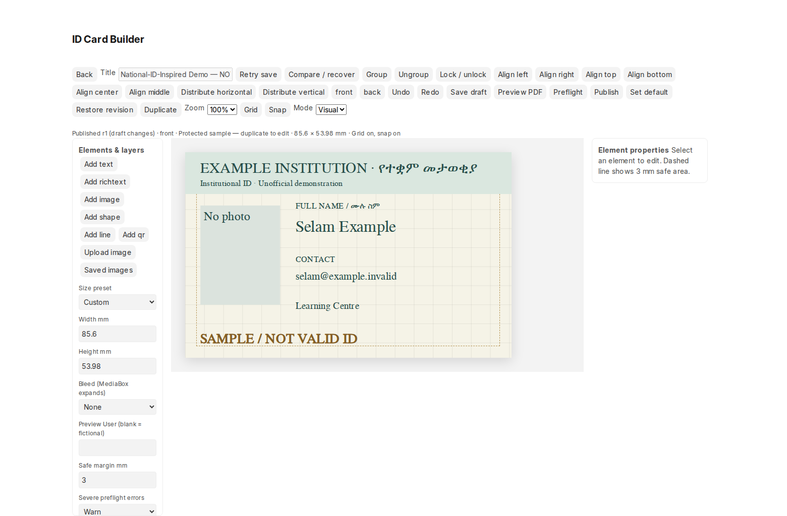
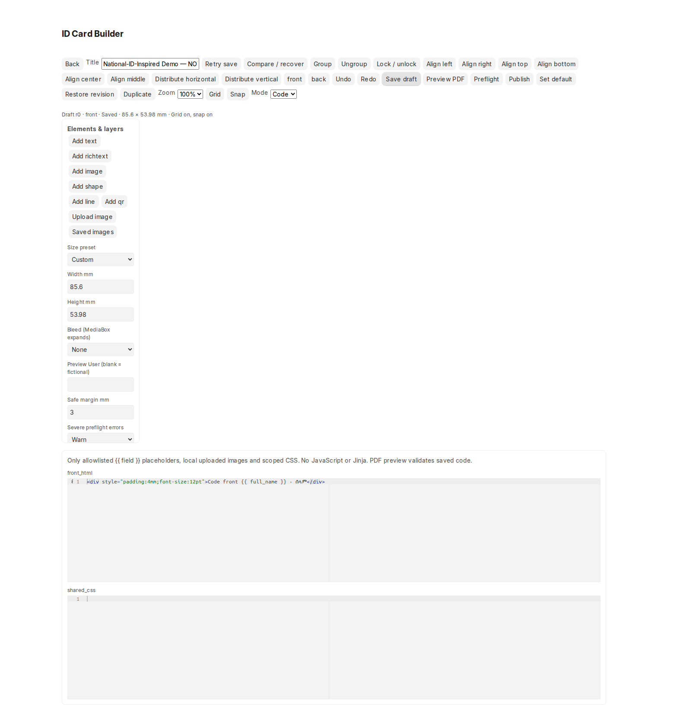
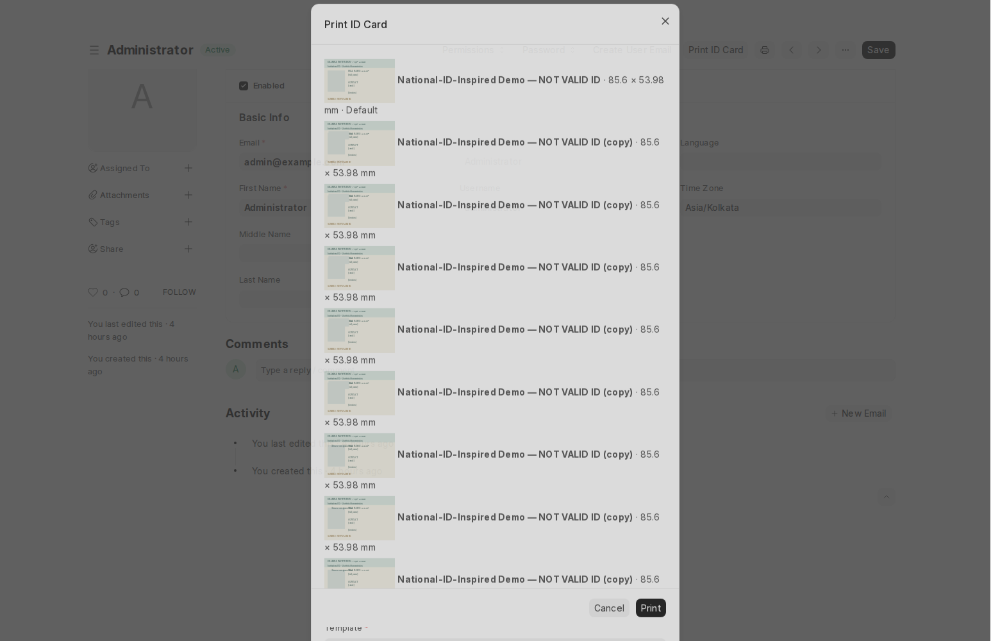

# ID Card Designer

A standalone Frappe app for designing and printing two-sided **institutional** ID cards from saved User records. This is **not an official Fayda issuer**. The protected sample is called **National-ID-Inspired Demo — NOT VALID ID** and visibly says **SAMPLE / NOT VALID ID** on both sides. It contains generic branding, fictional preview data, and no government symbols or verification codes.

## Working workflows

- **User → Print ID Card:** authorized staff select an active published template in a native Desk dialog. A directly reserved browser tab receives an actual inline PDF. Browser PDF viewers provide their normal Download and Print controls. Popup failures give an actionable message.
- **ID Card Designer workspace:** manage templates, create a blank design, duplicate the protected sample, configure settings, and inspect successful-print audit events.
- **Visual builder:** independent front/back scenes, canonical millimetre geometry, select/drag/resize, layer order, duplicate/delete, property editing, field picker, fallback text, conditional visibility, date formats, rotation, fonts/colors/borders, grid/snap, zoom, safety guides, undo/redo, keyboard nudges and Ctrl/Cmd+S. Images use Frappe uploads and attach to their template; saved images can be reused.
- **Publishing:** designers save drafts; managers publish, switch defaults, and restore earlier publications as drafts. Printing reads the published snapshot even while a draft changes. Revisions retain the last 30 previous publications.
- **Code mode:** converting a visual template creates a separate draft copy and warns that HTML edits do not convert back to layers. Front/back HTML and shared CSS use Frappe's local Ace editor. PDF preview validates saved source. Only `{{ approved_field }}` placeholders are supported; this is deliberately **not Jinja**.
- **Optional ID Card Profile:** one linked profile per User stores local-script name, department, role title, institution card reference and issue/expiry dates. It does not modify the core User schema. Missing or inaccessible profile values use template fallbacks.
- **PDF:** two separately rendered faces are merged in front/back order. Default trim is **85.60 × 53.98 mm**, zero margins. Optional 3 mm bleed expands the MediaBox to **91.60 × 59.98 mm**. Negative coordinates down to −3 mm can extend artwork into bleed. Preflight reports safety-margin, empty-binding, measured text-clipping, font and physical-bound warnings.





## Compatibility and verification

The supported matrix is Frappe **15.121.2 / Python 3.12 / Node 22** and **16.56.0 / Python 3.14 / Node 24**. See [TEST_RESULTS.md](TEST_RESULTS.md) for actual completed checks, exact versions and any release blockers. Early v16.2.1 has a reproducible upstream Desk desktop-icon boot failure and is not the release target. No core framework or unrelated app changes are required.

Phase two adds automatic draft saving/recovery, nested affine groups, rich text, a managed shared asset library, safe organizational QR, measured print preflight, crop marks and TrimBox metadata. Read the [admin/user guide](ADMIN_GUIDE.md) for setup, controls, security and recovery, and [changelog](CHANGELOG.md) for changes.

## Installation

Use a development/staging site first. From a compatible bench with the app cloned into `apps/id_card_designer`:

```bash
# Native libraries on Debian/Ubuntu, if not already installed:
sudo apt-get install libpango-1.0-0 libpangoft2-1.0-0 libharfbuzz-subset0

bench get-app --branch main https://github.com/natnaelTi/id_card_designer.git
bench --site YOUR-DEVELOPMENT-SITE install-app id_card_designer
bench build --app id_card_designer
bench --site YOUR-DEVELOPMENT-SITE clear-cache
```

The package declares its Python dependencies. No Chromium, wkhtmltopdf, remote fonts, CDN scripts, or separate Node application is required for production printing. GNU FreeSerif is bundled, embedded in PDFs and served locally in the designer; its separate license is under `public/fonts`. Other chosen font families must be installed locally and checked in the resulting PDF.

After updating this app, back up your target site and run the normal `bench --site SITE migrate`, `bench build --app id_card_designer`, and worker/web restart procedure. Install/migrate hooks create missing roles, workspace, settings and the demo **idempotently**. Existing demo content and customer designs are not overwritten. The default is initialized only when unconfigured; a manager can select a different enabled published template. The built-in and current default cannot be deleted; the default cannot be disabled.

## Permissions and setup

| Role | Draft design | Publish/default/settings | Generate cards |
| --- | --- | --- | --- |
| ID Card Designer | Yes | No | No, unless separately authorized |
| ID Card Printer | No | No | Yes, subject to User read **and print** permissions |
| ID Card Manager | Yes | Yes | Yes, subject to User permissions |
| System Manager / Administrator | Yes | Yes | Yes, subject to framework rules |

Assign roles through native User/Role tools. **This app does not grant broad User read/print access.** Frappe's standard User DocType grants those rights primarily to System Manager. An administrator must intentionally configure appropriate User permissions/shares for other printing staff. A role alone must not expose other Users. Additional printing roles in ID Card Settings also need native template-read access configured through Role Permission Manager.

Create optional profiles via `/app/id-card-profile`. Managers can edit a profile only with read access to its linked User. Profile values are returned only with both source-User and profile read access. Designers receive no automatic profile access. For conservative privacy, non-System-Manager profile lists show only their own linked record; authorized direct access to another profile still checks both permissions. Managers can set a template's allowed roles in its native form; audience restrictions also guard direct document reads.

Open `/app/id-card-builder` for a blank template, or use **Open Designer** on a saved template. Duplicate the built-in before editing. Set optional global dimensions/bleed and printing roles in ID Card Settings. Uploaded template images retain Frappe File permissions; private assets must be attached to a template that intended printers can read. Personal portraits additionally retain their source File permissions. Manager publication validates static asset access/content.

## Rendering and security contract

The visual language is limited to 100 objects per face and validated geometry/style/field bindings. Code mode allows a small HTML tag/attribute and CSS property set, with no scripts, event handlers, unrestricted template expressions, CSS imports, CSS URLs, or remote image paths. Values are inserted as text nodes, never evaluated. Image sources must be uploaded Frappe PNG/JPEG/WebP files or the approved User image binding. Images are permission-checked, decoded and re-encoded, limited to 5 MB and 24 megapixels. The render fetcher accepts only generated in-memory image/font data and performs no network/file URL requests.

Live rendering requires source-User read permission, and printing additionally requires print permission. Publication/default switching serialize through a database lock. Published snapshots and revision fields cannot be forged through normal document saving, including client-supplied flags. Every application endpoint checks its capability. PDFs are generated in memory; they are not stored as public File records. Only successful card generations append minimal audit metadata, without image/PDF bytes or extra profile values. Preview does not produce print audit records.

PDF delivery reserves a tab on the direct click, obtains a random 60-second user/session-bound capability, and submits it with the native CSRF token through **POST**. No User data or delivery token is placed in a URL. The delivery handler rechecks identity, permissions and template availability at render time. Responses are `application/pdf`, `inline`, `no-store, private` and `Referrer-Policy: no-referrer`.

## APIs

All names are under `id_card_designer.api`. Use `frappe.call`; mutations and PDF delivery require POST and normal CSRF validation.

| Method | Purpose |
| --- | --- |
| `capabilities(user?)` | Quiet capability check for native UI |
| `list_usable_templates()` | Permitted, enabled published gallery; published dimensions and default |
| `get_template_for_builder(name)` / `get_template(name)` | Authorized draft source and revision metadata |
| `save_draft(payload)` | Create/update allowed fields, with stale-save detection |
| `publish_template(name, modified?)` | Validate and snapshot current draft; manager only |
| `duplicate_template(name)` | Editable draft copy |
| `set_default_template(name)` | Transactional manager default switch |
| `get_field_schema()` | Runtime safe User and approved Profile fields |
| `get_preview_data(user?)` | Fictional data or permitted live data |
| `get_builder_defaults()` / `list_assets(name)` | Settings defaults and permitted attached images |
| `preflight_template(name, user?)` | Measured text/font, transformed bounds, bleed and QR report |
| `list_revisions(name)` / `restore_revision(name, revision)` | Inspect publications / restore as draft |
| `prepare_pdf(name, user?, preview=0)` | Short-lived `{url, token}` delivery descriptor |
| `deliver_pdf(token)` / `revoke_pdf(token)` | Session-bound inline delivery / owner-or-manager revocation |
| `draft_key()` | Per-login 24-hour recovery encryption key |
| `qr_preview(element, user?)` | Validated vector QR preview with User permission checks |
| `convert_to_code(name)` | Separate lossless scene scaffold draft |
| `list_global_assets()` / `upload_asset()` | Permission-checked shared assets and normalized private upload |
| `render_preview_pdf(name, user?)` | Direct POST of draft preview PDF |
| `print_user_id(name, user)` | Direct POST of published PDF plus success audit event |

## Verification and local artifacts

See [TEST_RESULTS.md](TEST_RESULTS.md) for commands, evidence and manual notes. A fresh export using only fictional data is reproducible without a site:

```bash
./env/bin/python apps/id_card_designer/scripts/export_demo.py
```

This writes `artifacts/demo.pdf` and reports its two page sizes. Generated PDF files are excluded from Git; the explicitly curated fictional QR PDF under `artifacts/phase2` is included as release evidence. Browser screenshots use only the isolated site's synthetic data. The production app contains no supplied reference photographs; those images were inspected only as composition references.

## Limits and deployment checks

- Supported HTML/CSS is deliberately bounded; code cannot execute Jinja/JavaScript or fetch remote assets. Visual-to-code scaffolds preserve scene semantics; arbitrary HTML-to-visual conversion is unsupported.
- Gallery thumbnails are schematic synthetic previews, not the full PDF rasterizer. Use actual PDF preview for approval.
- PDFs are RGB with embedded fonts, not certified PDF/X, CMYK or ICC-managed press files. Ask your print vendor to handle that separate production conversion and verify physical 100% scaling/duplex alignment.
- Automated browser coverage is Chromium at desktop and 390 px width. Firefox, Safari, real browser popup policies and physical printers need deployment testing.
- Templates support at most 100 objects/face and six nested group levels; QR and raster input limits are documented in the guide. Local recovery depends on available browser crypto/storage and the same login session.
- The app never implements government issuance or identity verification. No production-site rollout was performed.
